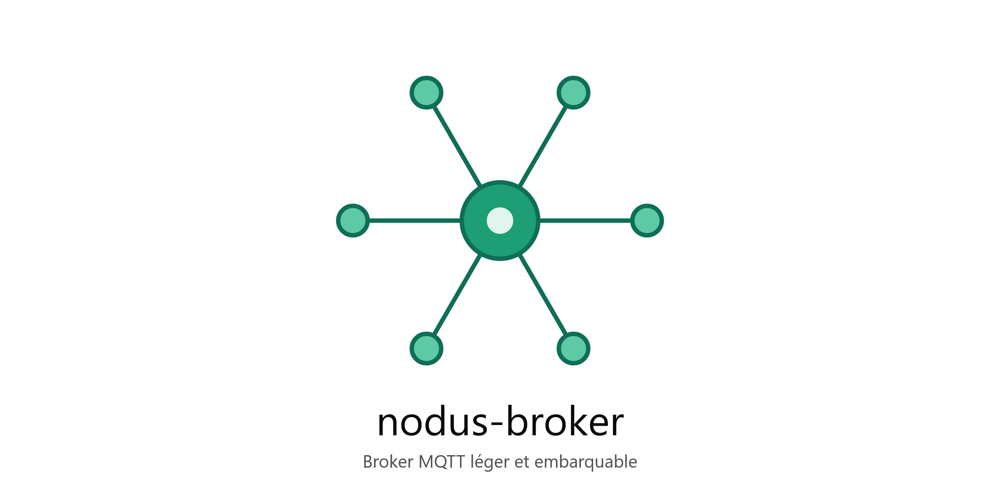

<div align="center">
  
  <h1>nodus-broker</h1>
  <p><strong>Un broker MQTT léger, haute performance et sécurisé</strong></p>
  <p>Conçu pour être embarqué et déployé sur des bancs et systèmes industriels</p>

  [](https://opensource.org/licenses/MIT)
  [](https://dotnet.microsoft.com/)
  [](https://mqtt.org/)
  []()

</div>

---

## 📋 Table des matières

- [Vue d'ensemble](#-vue-densemble)
- [Fonctionnalités](#-fonctionnalités)
- [Architecture](#-architecture)
- [Installation](#-installation)
- [Configuration](#-configuration)
- [Utilisation](#-utilisation)
- [Client CLI](#-client-cli)
- [Sécurité](#-sécurité)
- [Tests](#-tests)
- [Documentation](#-documentation)
- [Contribution](#-contribution)
- [License](#-license)

## 🎯 Vue d'ensemble

**nodus-broker** est un broker MQTT moderne développé en C# avec .NET 9.0, optimisé pour les environnements industriels et embarqués. Il offre une solution robuste, performante et facile à déployer pour vos besoins de communication IoT et M2M.

### Pourquoi nodus-broker ?

- **Léger et performant** : Empreinte mémoire réduite, idéal pour systèmes embarqués
- **Sécurisé par défaut** : Authentification, ACL par topic, protection anti brute-force
- **Facile à déployer** : Un seul exécutable, configuration JSON simple
- **Multi-protocole** : TCP, TLS, WebSocket
- **Industriel** : Conçu pour la fiabilité et la stabilité 24/7

## ✨ Fonctionnalités

### Protocole MQTT

- ✅ **MQTT 3.1.1** et **MQTT 5.0** (via MQTTnet)
- ✅ **QoS 0, 1, 2** : Tous les niveaux de qualité de service
- ✅ **Retained Messages** : Messages persistants
- ✅ **Persistent Sessions** : Sessions client persistantes
- ✅ **Wildcards** : Support complet de `+` et `#`
- ✅ **Clean/Persistent Sessions** : Gestion flexible des sessions

### Connectivité

- 🔌 **TCP** : Connexion standard MQTT (port 1883)
- 🔒 **TLS** : Connexion sécurisée avec certificats (port 8883)
- 🌐 **WebSocket** : Support WebSocket pour navigateurs (port configurable)

### Sécurité

- 🛡️ **Authentification par credentials** : Username/password avec hachage PBKDF2
- 🔐 **ACL par topic** : Contrôle granulaire des permissions publish/subscribe
- 🚫 **Protection anti brute-force** : Verrouillage IP après tentatives échouées
- 👥 **Système de rôles** : Gestion des permissions par rôles
- 🔑 **Placeholder {clientid}** : Topics personnalisés par client

### Performance

- ⚡ **Haute performance** : Gestion de centaines de clients simultanés
- 📊 **Limite de connexions configurable** : Protection contre la surcharge
- 🧵 **Async/Await** : Architecture asynchrone moderne
- 💾 **Empreinte mémoire optimisée** : Conçu pour environnements contraints

### Gestion et monitoring

- 📝 **Logging structuré** : Serilog avec niveaux configurables
- 🔍 **Topics système** : Statistiques broker via `$SYS/`
- 🎯 **Service Windows** : Déploiement en tant que service système
- 🚀 **Launcher** : Gestion simplifiée du démarrage/arrêt

## 🏗️ Architecture

```bash
nodus-broker/
├── src/
│   ├── nodus-broker/           # Broker MQTT principal
│   │   ├── Configuration/      # Options de configuration
│   │   ├── Security/           # Authentification, ACL, brute-force
│   │   ├── MqttBrokerService.cs
│   │   └── Program.cs
│   ├── bg-nodus-broker/        # Launcher/Service Windows
│   │   ├── BrokerLauncher.cs
│   │   └── Program.cs
│   └── nodus-cli/              # Client MQTT en ligne de commande
│       └── Program.cs
├── tests/
│   └── nodus-broker.Tests/     # Tests unitaires et intégration
│       ├── Security/
│       └── Integration/
├── tools/
│   ├── docfx/                  # Configuration DocFX
│   └── PasswordHashGenerator/  # Générateur de hash
└── doc/                        # Documentation
```

**Composants principaux :**

- **nodus-broker** : Broker MQTT basé sur MQTTnet avec authentification et ACL
- **bg-nodus-broker** : Launcher permettant de démarrer/arrêter le broker comme service
- **nodus-cli** : Client MQTT en ligne de commande pour tests et administration

## 📦 Installation

### Prérequis

- [.NET 9.0 SDK](https://dotnet.microsoft.com/download/dotnet/9.0)
- Windows, Linux ou macOS
- Port 1883 (TCP), 8883 (TLS) et WebSocket disponibles

### Installation depuis les sources

# Cloner le dépôt

git clone https://github.com/praffarin/nodus-broker.git
cd nodus-broker

# Compiler le broker

dotnet build src/nodus-broker/nodus-broker.csproj -c Release

# Compiler le launcher

dotnet build src/bg-nodus-broker/bg-nodus-broker.csproj -c Release

# Compiler le client CLI

dotnet build src/nodus-cli/nodus-cli.csproj -c Release

### Distribution binaire

```bash
# Créer une distribution autonome (Windows(x86,x64) et linux)
gendist.bat

# Les binaires seront dans ./dist/
```

### Installation comme service Windows

```bash
# Créer un service avec configuration par défaut
sc create NodusBroker binPath="C:\path\to\bg-nodus-broker.exe"
sc start NodusBroker

# Créer un service avec configuration personnalisée
sc create NodusBrokerProd binPath="C:\path\to\bg-nodus-broker.exe --config C:\configs\production.json"
sc start NodusBrokerProd

# Créer plusieurs instances avec des configurations différentes
sc create NodusBrokerSite1 binPath="C:\broker\bg-nodus-broker.exe -c C:\configs\site1.json"
sc create NodusBrokerSite2 binPath="C:\broker\bg-nodus-broker.exe -c C:\configs\site2.json"
```

## ⚙️ Configuration

La configuration se fait via le fichier `appsettings.json` ou un autre fichier passé en ligne de commande :

### Configuration de base

```json
{
  "Mqtt": {
    "Port": 1883,
    "TlsPort": 8883,
    "TlsEnabled": false,
    "MaxConnections": 500
  },
  "Auth": {
    "Mode": "Credentials",
    "Users": [
      {
        "Username": "admin",
        "PasswordHash": "<hash généré>",
        "Roles": ["admin"]
      }
    ]
  },
  "Security": {
    "MaxLoginAttempts": 5,
    "LockoutDurationSeconds": 300
  },
  "Acl": {
    "admin": [
      {
        "TopicPattern": "#",
        "Publish": true,
        "Subscribe": true
      }
    ]
  }
}
```

### Générer un hash de mot de passe

```bash
cd tools/PasswordHashGenerator
dotnet run -- "VotreMotDePasse"
# Copier le hash dans appsettings.json
```

### Modes d'authentification

#### Mode Credentials (recommandé)

```json
{
  "Auth": {
    "Mode": "Credentials",
    "Users": [
      {
        "Username": "device001",
        "PasswordHash": "<hash>",
        "Roles": ["device"]
      }
    ]
  }
}
```

#### Mode Anonymous

```json
{
  "Auth": {
    "Mode": "Anonymous",
    "AnonymousRoles": ["guest"]
  }
}
```

### Configuration des ACL

Exemples de règles d'accès par topic :

```json
{
  "Acl": {
    "admin": [
      {
        "TopicPattern": "#",
        "Publish": true,
        "Subscribe": true
      }
    ],
    "device": [
      {
        "TopicPattern": "sensor/#",
        "Publish": true,
        "Subscribe": false
      },
      {
        "TopicPattern": "device/{clientid}/#",
        "Publish": true,
        "Subscribe": true
      }
    ],
    "monitoring": [
      {
        "TopicPattern": "sensor/#",
        "Publish": false,
        "Subscribe": true
      }
    ]
  }
}
```

**Wildcards supportés :**

- `+` : Un seul niveau (ex: `sensor/+/temperature`)
- `#` : Multi-niveaux (ex: `sensor/#`)
- `{clientid}` : Remplacé par l'ID du client (ex: `device/{clientid}/status`)

### Configuration TLS

```json
{
  "Mqtt": {
    "TlsEnabled": true,
    "TlsPort": 8883,
    "TlsCertificatePath": "./certs/server.pfx",
    "TlsCertificatePassword": "<password>"
  }
}
```

### Configuration WebSocket

```json
{
  "WebSocket": {
    "Enabled": true,
    "Port": 8080,
    "Path": "/mqtt"
  }
}
```

## 🚀 Utilisation

### Démarrer le broker

#### Avec nodus-broker directement

```bash
# Configuration par défaut (appsettings.json dans le répertoire courant)
cd src/nodus-broker
dotnet run

# Configuration personnalisée
dotnet run --project src/nodus-broker -- --config "C:\config\production.json"
dotnet run --project src/nodus-broker -- -c "/etc/nodus-broker/config.json"

# Exécutable compilé
nodus-broker.exe --config "D:\configs\test.json"
nodus-broker.exe -c "custom-config.json"
```

**Note importante** : Si le fichier de configuration spécifié est introuvable, le broker affiche un message d'erreur et se termine avec le code de sortie 1.

#### Avec bg-nodus-broker (launcher)

```bash
# Configuration par défaut
bg-nodus-broker.exe

# Configuration personnalisée
bg-nodus-broker.exe --config "C:\config\production.json"
bg-nodus-broker.exe -c "D:\configs\development.json"

# Arrêt du broker (indépendant de la config)
bg-nodus-broker.exe --stop
```

**Validation automatique** : Le launcher vérifie l'existence du fichier de configuration avant de démarrer le broker.

#### Scénarios d'utilisation

```bash
# Environnement de développement
bg-nodus-broker.exe -c appsettings.Development.json

# Environnement de production
bg-nodus-broker.exe -c appsettings.Production.json

# Tests avec configuration spécifique
bg-nodus-broker.exe -c appsettings.Test.json

# Configuration réseau spécifique
bg-nodus-broker.exe -c "\\server\configs\site-A.json"

# Configuration avec chemin absolu
nodus-broker.exe --config "C:\Program Files\Nodus\config\broker.json"

# Configuration avec chemin relatif
nodus-broker.exe -c "../configs/site-specific.json"
```

#### Gestion des erreurs

```bash
# Si le fichier n'existe pas, le broker se termine avec le code d'erreur 1
nodus-broker.exe --config "nonexistent.json"
# Sortie : ERREUR: Le fichier de configuration 'nonexistent.json' est introuvable.
# Code de sortie : 1

# Vérification dans un script batch (Windows)
bg-nodus-broker.exe -c custom.json
if %ERRORLEVEL% NEQ 0 (
    echo La configuration est introuvable ou invalide
    exit /b 1
)

# Vérification dans un script bash (Linux)
./nodus-broker --config custom.json
if [ $? -ne 0 ]; then
    echo "La configuration est introuvable ou invalide"
    exit 1
fi

# Vérification dans PowerShell
.\nodus-broker.exe -c custom.json
if ($LASTEXITCODE -ne 0) {
    Write-Error "La configuration est introuvable ou invalide"
    exit 1
}
```

#### Avantages de la configuration paramétrable

✅ **Multi-environnement** : Facile de basculer entre dev/test/prod  
✅ **Déploiement flexible** : Configuration centralisée possible (partage réseau, etc.)  
✅ **Tests isolés** : Chaque instance peut avoir sa propre config  
✅ **Compatibilité ascendante** : Fonctionne sans argument (comportement par défaut conservé)  
✅ **Validation précoce** : Erreur explicite si le fichier n'existe pas (code sortie 1)  
✅ **Service Windows** : Le chemin de config peut être passé dans les arguments du service  
✅ **Arguments nettoyés** : Les arguments `--config`/`-c` sont filtrés et ne polluent pas ASP.NET Core  
✅ **Scriptable** : Code de sortie exploitable dans les scripts d'automatisation

#### Exemple de déploiement multi-instances

```bash
# Instance 1 : Port 1883
bg-nodus-broker.exe -c config-instance1.json

# Instance 2 : Port 1884 (sur une autre machine ou avec des ports différents)
bg-nodus-broker.exe -c config-instance2.json
```

### Logs

Les logs sont affichés dans la console et peuvent être configurés via `appsettings.json` :

```json
{
  "Serilog": {
    "MinimumLevel": {
      "Default": "Information",
      "Override": {
        "Microsoft": "Warning",
        "System": "Warning"
      }
    }
  }
}
```

## 🖥️ Client CLI

**nodus-cli** est un client MQTT en ligne de commande pour interagir avec le broker.

### Publier un message

```bash
# Message simple
nodus-cli publish -t "sensor/temperature" -m "23.5"

# Avec authentification
nodus-cli publish -t "sensor/temp" -m "23.5" -u "device001" -P "password"

# Avec QoS et retain
nodus-cli publish -t "config/version" -m "1.0.0" -q 1 -r

# Sur un broker distant
nodus-cli publish -h "192.168.1.100" -p 1883 -t "test" -m "Hello"
```

### S'abonner à des topics

```bash
# Abonnement simple
nodus-cli subscribe -t "sensor/#"

# Plusieurs topics
nodus-cli subscribe -t "sensor/+/temperature" -t "device/+/status"

# Avec authentification
nodus-cli subscribe -t "sensor/#" -u "monitoring" -P "password"

# Avec QoS
nodus-cli subscribe -t "alerts/#" -q 1
```

### Options disponibles

```
Options communes:
  -h, --host       Adresse du broker (défaut: localhost)
  -p, --port       Port du broker (défaut: 1883)
  -u, --username   Nom d'utilisateur
  -P, --password   Mot de passe
  -i, --client-id  Identifiant client (auto-généré par défaut)

Options publish:
  -t, --topic      Topic MQTT (requis)
  -m, --message    Message à publier (requis)
  -q, --qos        Qualité de service 0/1/2 (défaut: 0)
  -r, --retain     Message retained

Options subscribe:
  -t, --topic      Topics MQTT (peut être répété)
  -q, --qos        Qualité de service 0/1/2 (défaut: 0)
```

## 🔒 Sécurité

### Authentification

- **Hachage PBKDF2** : SHA-256, 100 000 itérations, sel 128 bits
- **Stockage sécurisé** : Format `{salt_base64}.{hash_base64}`
- **Comparaison en temps constant** : Protection contre les attaques par timing

### Protection anti brute-force

- **Verrouillage par IP** : Après N tentatives échouées (configurable)
- **Durée de verrouillage** : Configurable (défaut: 5 minutes)
- **Nettoyage automatique** : Suppression des entrées expirées

### ACL (Access Control List)

- **Permissions granulaires** : Publish/Subscribe séparés
- **Par rôle** : Attribution de multiples rôles par utilisateur
- **Wildcards MQTT** : Support complet de `+` et `#`
- **Placeholder {clientid}** : Topics personnalisés par client
- **Protection des topics système** : `$SYS/` non matchables par wildcards

### Bonnes pratiques

1. **Mode Credentials en production** : Ne jamais utiliser Anonymous en production
2. **Mots de passe forts** : Minimum 12 caractères, mixte
3. **Principe du moindre privilège** : Accorder uniquement les permissions nécessaires
4. **TLS activé** : Chiffrement des communications
5. **Logs de sécurité** : Surveiller les tentatives d'authentification échouées

## 🧪 Tests

Suite complète de tests automatisés avec xUnit.

### Tests unitaires (45 tests)

```bash
# Tous les tests unitaires
dotnet test tests/nodus-broker.Tests --filter "FullyQualifiedName~Security"

# Tests spécifiques
dotnet test tests/nodus-broker.Tests --filter "PasswordHasher"
dotnet test tests/nodus-broker.Tests --filter "BruteForceGuard"
dotnet test tests/nodus-broker.Tests --filter "TopicAclValidator"
```

### Tests d'intégration (8 tests)

```bash
# Démarrer d'abord le broker
cd src/nodus-broker
dotnet run

# Dans un autre terminal
dotnet test tests/nodus-broker.Tests --filter "Integration"
```

### Couverture de code

```bash
dotnet test tests/nodus-broker.Tests --collect:"XPlat Code Coverage"
```

### Tests couverts

- ✅ Hachage et vérification de mots de passe
- ✅ Protection anti brute-force
- ✅ Validation des ACL et wildcards
- ✅ Connexion et authentification MQTT
- ✅ Publication QoS 0/1/2
- ✅ Abonnements et wildcards
- ✅ Messages retained
- ✅ Connexions multiples

Consultez [tests/nodus-broker.Tests/README.md](tests/nodus-broker.Tests/README.md) pour plus de détails.

## 📚 Documentation

### Documentation API

Génération de la documentation avec DocFX :

```bash
# Installer DocFX
dotnet tool install -g docfx

# Générer la documentation
docfx tools/docfx/docfx.json

# Servir localement
docfx serve tools/docfx/_site
```

La documentation XML est générée automatiquement lors de la compilation.

### Documentation utilisateur

- [Guide de démarrage rapide](doc/quickstart.md)
- [Configuration avancée](doc/configuration.md)
- [Guide de sécurité](doc/security.md)
- [FAQ](doc/faq.md)

## 🏭 Déploiement en production

### Checklist de production

- [ ] Mode `Credentials` activé
- [ ] TLS configuré avec certificats valides
- [ ] ACL configurées selon le principe du moindre privilège
- [ ] Protection anti brute-force activée
- [ ] Logs configurés (niveau Information minimum)
- [ ] `MaxConnections` ajusté selon la capacité
- [ ] Service Windows configuré pour démarrage automatique
- [ ] Sauvegarde de la configuration
- [ ] Monitoring des logs en place

### Supervision

```bash
# Topics système pour monitoring
$SYS/broker/version
$SYS/broker/uptime
$SYS/broker/clients/connected
$SYS/broker/messages/received
$SYS/broker/messages/sent
```

### Performance

**Benchmarks typiques** (Windows Server 2019, 8 cores, 16GB RAM) :

- Connexions simultanées : 500+
- Messages/seconde : 10 000+
- Latence moyenne (QoS 0) : < 1ms
- Empreinte mémoire : ~50-100MB

## 🤝 Contribution

Les contributions sont les bienvenues !

### Comment contribuer

1. **Fork** le projet
2. Créer une branche (`git checkout -b feature/amazing-feature`)
3. Commit les changements (`git commit -m 'Add amazing feature'`)
4. Push vers la branche (`git push origin feature/amazing-feature`)
5. Ouvrir une **Pull Request**

### Standards de code

- Suivre les conventions C# .NET
- Documenter le code avec XML comments
- Ajouter des tests pour les nouvelles fonctionnalités
- Maintenir une couverture de code > 80%

### Rapporter un bug

Ouvrez une [issue](https://github.com/votre-username/nodus-broker/issues) avec :

- Description du problème
- Étapes pour reproduire
- Version de nodus-broker
- Logs pertinents

## 📝 Roadmap

- [ ] Support MQTT 5.0 complet (propriétés étendues)
- [ ] Interface Web d'administration
- [ ] Métriques Prometheus
- [ ] Clustering et haute disponibilité
- [ ] Bridge MQTT vers autres brokers
- [ ] Plugin system
- [ ] Support Docker officiel

## 📄 License

Ce projet est sous licence MIT - voir le fichier [LICENSE](LICENSE) pour plus de détails.

```
MIT License

Copyright (c) 2026 RAFFARIN Pascal

Permission is hereby granted, free of charge, to any person obtaining a copy
of this software and associated documentation files (the "Software"), to deal
in the Software without restriction...
```

## 👏 Remerciements

- [MQTTnet](https://github.com/dotnet/MQTTnet) - Excellente bibliothèque MQTT pour .NET
- [Serilog](https://serilog.net/) - Logging structuré
- [xUnit](https://xunit.net/) - Framework de tests
- [FluentAssertions](https://fluentassertions.com/) - Assertions expressives

## 📧 Contact

**RAFFARIN Pascal**

- GitHub: [@praffarin](https://github.com/praffarin)
- Email: pascal.raffarin@laposte.net

---

<div align="center">
  <p>Développé avec ❤️ pour l'industrie et l'embarqué</p>
  <p>⭐ N'oubliez pas de mettre une étoile si ce projet vous est utile !</p>
</div>
